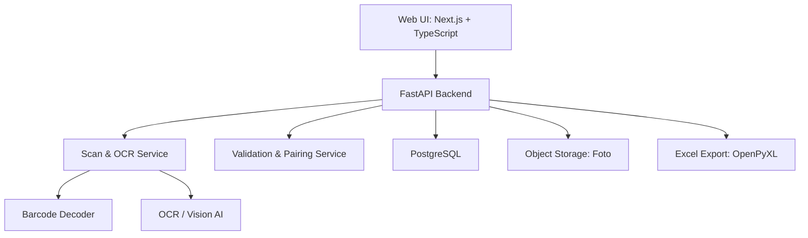
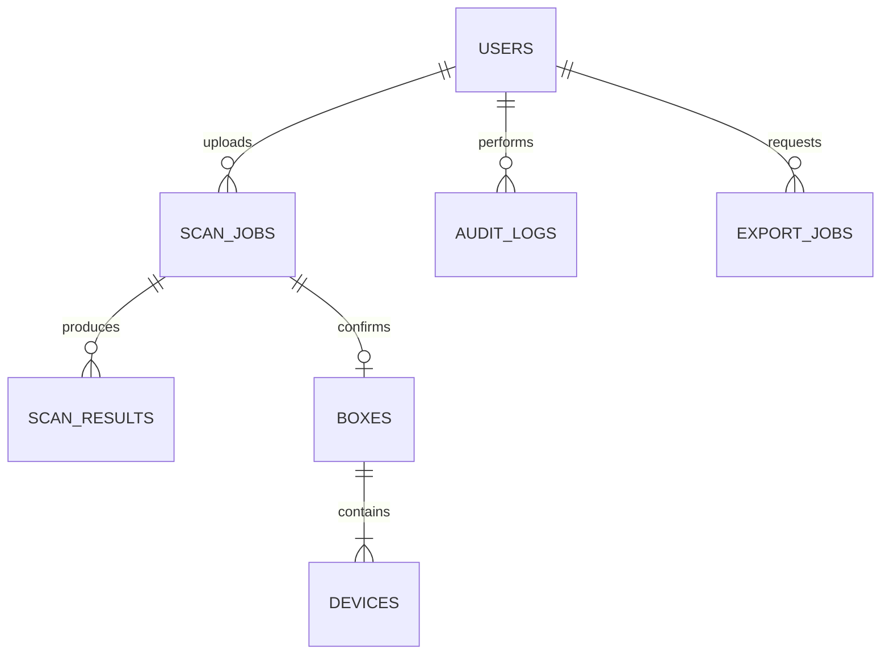

# Product Requirements Document (PRD)

# Warehouse Smart Label Scanner — MVP 1.0

| Metadata | Nilai |
|---|---|
| Versi | 1.0 (Draft for Review) |
| Tanggal | 10 November 2026 |
| Pemilik Dokumen | Product / Project Management & Business Analysis |
| Platform | Web responsif |
| Volume Operasional | < 100 box/hari |
| Format Label | Satu format standar (label router MF296A2 sebagai referensi) |
| Penyimpanan | PostgreSQL + object storage untuk foto |
| Output | Inventaris database dan file Excel (.xlsx) |
| Estimasi MVP | 6 minggu, bergantung hasil discovery dan PoC OCR |

## 1. Executive Summary

Warehouse saat ini memasukkan data identitas perangkat pada label kardus secara manual. Setiap kardus dapat berisi beberapa perangkat dengan MAC Address dan Serial Number (SN) yang berbeda. Proses membaca, mengetik, memindai, memeriksa, dan merekap data satu per satu menyebabkan waktu kerja berulang, risiko salah input, serta keterbatasan audit.

**Solusi:** aplikasi web internal yang menerima foto label, membaca barcode dan teks menggunakan OCR/Vision AI, memasangkan MAC dengan SN, memvalidasi data, memungkinkan koreksi oleh operator, menyimpan data terkonfirmasi dalam database, dan mengekspor data ke Excel dengan satu baris per perangkat.

**Prinsip utama:** AI membantu ekstraksi, tetapi tidak boleh mengarang karakter yang tidak terbaca. Data inventaris final hanya dibuat setelah operator menyetujui hasil validasi.

## 2. Problem Statement & Business Goals

### 2.1 As-Is
1. Operator menerima kardus dan melihat label.
2. Operator membaca atau memindai identitas perangkat satu per satu.
3. Operator mengetik MAC/SN serta data box secara manual.
4. Operator memeriksa ulang dan merekap data ke Excel.

### 2.2 Bottleneck
- Input repetitif untuk setiap perangkat di satu box.
- Risiko salah ketik, tertukar pasangan MAC/SN, dan duplikasi.
- Foto sumber dan data inventaris tidak terhubung.
- Sulit menelusuri riwayat koreksi.

### 2.3 To-Be
Upload foto → pemeriksaan kualitas → barcode/OCR → pemetaan field → validasi → review/koreksi → konfirmasi → simpan database → ekspor Excel.

### 2.4 Business Objectives
- Meminimalkan input manual per unit.
- Mempercepat proses pencatatan box.
- Meningkatkan akurasi identitas perangkat.
- Menciptakan satu sumber data inventaris yang dapat diaudit.
- Menghasilkan file Excel yang konsisten.

## 3. Scope, Assumptions & Dependencies

### 3.1 In Scope (MVP)
- Login/logout dan role-based access control.
- Upload satu foto JPG/PNG per scan.
- Penyimpanan foto sumber dan riwayat scan.
- OCR teks, barcode decoding, dan ekstraksi field standar.
- Ekstraksi seluruh MAC/SN dalam satu label serta pairing berdasarkan baris/posisi.
- Validasi format, quantity, kelengkapan, dan duplikasi.
- Review/edit hasil ekstraksi sebelum simpan.
- Penyimpanan box dan unit secara atomik.
- Pencarian dan riwayat data.
- Ekspor Excel (.xlsx), satu baris per perangkat.
- Audit dasar atas konfirmasi dan koreksi data final.

### 3.2 Out of Scope
- Dukungan semua format label vendor.
- Bulk upload ribuan gambar.
- Aplikasi Android/iOS native dan offline mode.
- Integrasi ERP/WMS, handheld scanner, dan lokasi rak real-time.
- Rekonsiliasi stok otomatis dan analytics lanjutan.

### 3.3 Assumptions
- Volume di bawah 100 box per hari.
- Template label konsisten, walaupun kualitas foto dapat berbeda.
- Operator memiliki akses internet/intranet dan browser modern.
- Kebijakan retensi foto, keamanan, dan hosting disetujui pemilik sistem.

### 3.4 Dependencies
- Sampel 100–200 foto label nyata dan ground-truth MAC/SN untuk pengujian.
- Akses hosting, database, storage, dan penyedia OCR yang disetujui.
- Penunjukan Product Owner warehouse untuk keputusan dan UAT.

## 4. Stakeholders, Personas & Access

| Peran | Kebutuhan | Hak Akses |
|---|---|---|
| Operator Warehouse | Scan, review, simpan, cari, ekspor | Buat scan, koreksi sebelum konfirmasi, ekspor |
| Supervisor | Pantau kualitas, koreksi final, audit | Semua hak operator + koreksi data final dan audit |
| Admin | Pengelolaan akses dan konfigurasi | Semua hak + kelola pengguna dan sistem |
| Product Owner | Menyetujui kebutuhan dan UAT | Pengambil keputusan bisnis |
| Developer/QA | Implementasi dan pengujian | Akses sesuai lingkungan kerja |

**Aturan:** operator tidak dapat mengubah inventaris final; koreksi oleh supervisor/admin wajib mencatat alasan, nilai lama, nilai baru, aktor, dan waktu.

## 5. Functional Requirements

| ID | Requirement | Prioritas |
|---|---|---|
| FR-001 | Login/logout dan otorisasi per role | P0 |
| FR-002 | Upload JPG/PNG dengan batas ukuran terkonfigurasi | P0 |
| FR-003 | Validasi MIME, ukuran, integritas, dan kualitas gambar | P0 |
| FR-004 | OCR teks dan pembacaan barcode | P0 |
| FR-005 | Ekstraksi box number, code, model, quantity, dan metadata label | P0 |
| FR-006 | Ekstraksi multi-MAC dan multi-SN | P0 |
| FR-007 | Pairing MAC/SN berdasarkan baris dan layout | P0 |
| FR-008 | Preview dan koreksi hasil ekstraksi | P0 |
| FR-009 | Validasi quantity vs jumlah unit/pasangan | P0 |
| FR-010 | Validasi MAC 12 karakter heksadesimal | P0 |
| FR-011 | Deteksi duplikasi MAC, SN, dan Box Number | P0 |
| FR-012 | Konfirmasi dan simpan data secara atomik | P0 |
| FR-013 | Riwayat scan dan detail box/foto | P0 |
| FR-014 | Ekspor .xlsx satu baris per unit | P0 |
| FR-015 | Penegakan permission di backend | P0 |
| FR-016 | Audit log koreksi data final | P1 (wajib jika fitur koreksi final aktif) |
| FR-017 | Filter tanggal, model, operator, box, MAC/SN | P1 |
| FR-018 | Dashboard ringkas volume dan status | P1 |
| FR-019 | Batch upload | P2 |
| FR-020 | Integrasi ERP/WMS | P2 |

P0 = wajib untuk MVP; P1 = setelah alur inti stabil; P2 = fase berikutnya.

## 6. User Stories & Acceptance Criteria

### US-01 — Upload Label
**Sebagai** operator, **saya ingin** mengunggah foto label agar tidak perlu mengetik semua data.

**Acceptance Criteria:**
- Given operator login, when memilih JPG/PNG valid, then foto dapat diunggah dan dipreview.
- File rusak, jenis tidak didukung, atau melampaui batas ditolak dengan pesan jelas.
- Setiap upload memiliki scan ID, operator, waktu, dan referensi foto.

### US-02 — Ekstraksi Otomatis
**Sebagai** operator, **saya ingin** semua MAC dan SN dari satu foto terbaca otomatis.

**Acceptance Criteria:**
- Sistem membaca field wajib box dan seluruh unit yang ditemukan.
- Label dengan quantity 4 menghasilkan empat pasangan ketika seluruh data terbaca.
- Field yang ambigu/kosong ditandai; sistem tidak menebak karakter.
- Konflik hasil barcode dan OCR ditampilkan untuk pemeriksaan.

### US-03 — Review dan Koreksi
**Sebagai** operator, **saya ingin** memperbaiki hasil OCR sebelum disimpan.

**Acceptance Criteria:**
- Field hasil ekstraksi ditampilkan dan dapat dikoreksi sebelum konfirmasi.
- Kesalahan validasi ditandai per field dan diperbarui setelah perubahan.
- Tidak ada record inventaris final sebelum tombol Confirm & Save berhasil.

### US-04 — Pencegahan Duplikasi
**Sebagai** operator, **saya ingin** mengetahui apakah identitas sudah tercatat.

**Acceptance Criteria:**
- MAC dan SN dibandingkan dengan database menggunakan normalisasi yang konsisten.
- Duplikasi menampilkan referensi record existing tanpa membuat data baru.
- Konfirmasi ditolak saat terjadi konflik; database tetap memiliki unique constraint.
- Permintaan konfirmasi yang diulang tidak menggandakan data (idempotent).

### US-05 — Simpan Inventaris
**Sebagai** operator, **saya ingin** satu box dan semua unit disimpan bersama.

**Acceptance Criteria:**
- Penyimpanan box dan perangkat dilakukan dalam satu transaksi database.
- Jika satu record gagal, seluruh transaksi dibatalkan.
- Tiap perangkat memiliki relasi ke box dan foto sumber.
- Pesan sukses hanya muncul setelah commit berhasil.

### US-06 — Ekspor Excel
**Sebagai** operator, **saya ingin** mengunduh hasil scan sebagai Excel.

**Acceptance Criteria:**
- File .xlsx dapat dibuka di Microsoft Excel.
- Setiap unit berada di satu baris.
- Field box yang sama direplikasi secara konsisten ke setiap baris unit.
- MAC, SN, Box Number, dan Product Code diformat sebagai teks.
- Jumlah baris data sesuai jumlah unit terkonfirmasi yang dipilih.

### US-07 — History & Search
**Sebagai** supervisor, **saya ingin** menelusuri data yang sudah dicatat.

**Acceptance Criteria:**
- Riwayat menampilkan box, tanggal, jumlah unit, operator, dan status.
- Pencarian Box Number, MAC, dan SN menampilkan data yang relevan.
- Detail record menampilkan foto sumber sesuai permission.

### US-08 — Koreksi Data Final
**Sebagai** supervisor, **saya ingin** mengoreksi kesalahan setelah konfirmasi dengan jejak audit.

**Acceptance Criteria:**
- Operator biasa ditolak jika mencoba mengubah record final.
- Supervisor/admin wajib memasukkan alasan koreksi.
- Sistem mencatat before/after, aktor, dan timestamp.
- Unique constraint tetap berlaku setelah koreksi.

## 7. Business Rules & Validation

| ID | Aturan | Perilaku |
|---|---|---|
| BR-01 | Satu box memiliki banyak perangkat | Buat 1 box + N device |
| BR-02 | Jumlah MAC = Quantity | Blokir confirm bila tidak cocok |
| BR-03 | Jumlah SN = Quantity | Blokir confirm bila tidak cocok |
| BR-04 | Setiap unit memiliki satu MAC dan satu SN | Wajib pairing jelas |
| BR-05 | MAC berisi 12 digit heksadesimal | Normalisasi uppercase, tolak karakter invalid |
| BR-06 | SN mengikuti aturan model | Konfigurasi awal MF296A2: 12 digit numerik; verifikasi dengan pemilik proses |
| BR-07 | MAC dan SN unik global | Blokir duplikasi |
| BR-08 | Box Number unik pada inventaris aktif | Upload ulang tidak membuat box ganda |
| BR-09 | Nilai ambigu/konflik wajib review | Jangan auto-confirm |
| BR-10 | Simpan seluruh unit atomik | Rollback jika gagal |
| BR-11 | Hanya data confirmed masuk Excel final | Draft tidak diekspor sebagai inventaris |
| BR-12 | Audit koreksi final | Simpan perubahan dan alasan |

## 8. Data Dictionary dan Contoh Label

### 8.1 Box-Level Fields
- `box_number`: 320080532609300067
- `product_code`: 123480201002
- `model`: MF296A2
- `quantity`: 4
- `weight_grams`: 3891
- `color`: White
- `category`: FWT
- `accessory`: 1C
- `box_status`: Full
- `manufacture_country`: China
- `label_date`: 2026-10-15
- `qa_req_no`: SJS2610146011
- `plg_id`: 1899
- `qr_text`: 126679/DJID/2026 (teks tercetak di bawah QR; isi QR harus didekode terpisah)

### 8.2 Unit-Level Fields

| Urutan | MAC Address | Serial Number |
|---|---|---|
| 1 | 5CFFA94CCC9B | 324462875625 |
| 2 | 5CFFA94CCC8B | 324462875609 |
| 3 | 5CFFA94CCAA8 | 324462875126 |
| 4 | 5CFFA94CCB41 | 324462875279 |

**Catatan kualitas data:** data di atas adalah transkripsi contoh foto dan wajib diverifikasi dari label/barcode asli sebelum menjadi ground truth. Seluruh identifier harus disimpan sebagai string, bukan integer.

## 9. UX / Screen Requirements

1. **Login:** email/username, password, pesan error yang aman.
2. **Upload:** drag-and-drop/pilih foto, preview, panduan kualitas foto, status proses.
3. **Processing:** indikator status scan dan error/retry yang jelas.
4. **Review:** data box, tabel unit, indikator invalid/ambigu, foto berdampingan, edit, confirm.
5. **History:** tabel scan/box, pencarian, filter, pagination.
6. **Box Detail:** metadata box, unit, foto sumber, riwayat perubahan.
7. **Export:** filter, ringkasan jumlah record, tombol unduh Excel.
8. **Admin (minimal):** pengelolaan akun dan role.

Status scan: `uploaded`, `processing`, `needs_review`, `ready`, `confirmed`, `failed`. Status yang gagal harus dapat ditinjau dan diproses ulang tanpa membuat duplikasi.

## 10. Architecture & Technical Design

### 10.1 Recommended Architecture
**Modular monolith** untuk volume <100 box/hari.



### 10.2 Technology Stack
| Layer | Rekomendasi |
|---|---|
| Frontend | Next.js, TypeScript, Tailwind CSS |
| Backend | Python FastAPI |
| OCR | OCR engine + Vision AI dengan provider abstraction |
| Barcode | ZXing atau ZBar |
| Database | PostgreSQL |
| Storage | S3-compatible object storage |
| Excel | OpenPyXL |
| Deployment | Docker + managed hosting |
| Security | HTTPS, secure session/JWT, RBAC, least privilege |

### 10.3 Processing Pipeline
1. Terima file, validasi MIME/ukuran, dan simpan foto asli.
2. Lakukan preprocessing opsional: rotate, crop, peningkatan kontras.
3. Dekode barcode terlebih dahulu bila memungkinkan.
4. Jalankan OCR teks dan ekstraksi layout.
5. Petakan field box dan pasangan MAC/SN per baris.
6. Bandingkan hasil barcode dan OCR; konflik ditandai.
7. Jalankan validasi deterministic dan cek duplikasi.
8. Sajikan hasil draft untuk review operator.
9. Setelah disetujui, simpan atomik ke inventaris.
10. Izinkan pencarian dan ekspor data confirmed.

## 11. Database Schema

### 11.1 ERD Konseptual



### 11.2 Tables

**users**
- `id UUID PK`
- `full_name VARCHAR(150) NOT NULL`
- `email VARCHAR(255) UNIQUE NOT NULL`
- `password_hash TEXT NOT NULL`
- `role VARCHAR(20) NOT NULL` (`operator`, `supervisor`, `admin`)
- `is_active BOOLEAN DEFAULT TRUE`
- `created_at TIMESTAMPTZ NOT NULL`

**scan_jobs**
- `id UUID PK`
- `uploaded_by UUID FK -> users.id`
- `image_path TEXT NOT NULL`
- `image_sha256 CHAR(64)` (index)
- `status VARCHAR(30) NOT NULL`
- `ocr_provider VARCHAR(50)`
- `processing_ms INTEGER`
- `error_message TEXT`
- `created_at TIMESTAMPTZ NOT NULL`

**scan_results**
- `id UUID PK`
- `scan_job_id UUID FK -> scan_jobs.id`
- `extracted_data JSONB NOT NULL`
- `corrected_data JSONB`
- `validation_errors JSONB`
- `reviewed_by UUID FK -> users.id`
- `reviewed_at TIMESTAMPTZ`

**boxes**
- `id UUID PK`
- `box_number VARCHAR(80) UNIQUE NOT NULL`
- `product_code VARCHAR(80)`
- `model VARCHAR(80) NOT NULL`
- `quantity INTEGER NOT NULL CHECK (quantity > 0)`
- `weight_grams INTEGER`
- `color VARCHAR(40)`
- `category VARCHAR(40)`
- `accessory VARCHAR(40)`
- `box_status VARCHAR(40)`
- `manufacture_country VARCHAR(80)`
- `label_date DATE`
- `qa_req_no VARCHAR(80)`
- `plg_id VARCHAR(80)`
- `qr_text TEXT`
- `source_scan_id UUID UNIQUE FK -> scan_jobs.id`
- `created_at TIMESTAMPTZ NOT NULL`

**devices**
- `id UUID PK`
- `box_id UUID FK -> boxes.id`
- `unit_sequence INTEGER NOT NULL`
- `mac_address CHAR(12) UNIQUE NOT NULL`
- `serial_number VARCHAR(80) UNIQUE NOT NULL`
- `created_at TIMESTAMPTZ NOT NULL`
- `UNIQUE (box_id, unit_sequence)`

**audit_logs**
- `id UUID PK`
- `actor_id UUID FK -> users.id`
- `entity_type VARCHAR(50)`
- `entity_id UUID`
- `action VARCHAR(50)`
- `before_data JSONB`
- `after_data JSONB`
- `reason TEXT`
- `created_at TIMESTAMPTZ NOT NULL`

**export_jobs**
- `id UUID PK`
- `requested_by UUID FK -> users.id`
- `filters JSONB`
- `record_count INTEGER`
- `file_path TEXT`
- `created_at TIMESTAMPTZ NOT NULL`

### 11.3 Integrity Rules
- Unique index MAC dan SN di database; normalisasi sebelum penyimpanan.
- FK wajib konsisten, transaksi box+devices atomik.
- `confirm` menggunakan idempotency key atau state transition yang aman.
- Foto asli disimpan di object storage; database menyimpan path dan metadata.
- Audit log disimpan untuk aksi sensitif; akses sesuai role.

## 12. API Specification (Draft)

| Method | Endpoint | Fungsi |
|---|---|---|
| POST | `/api/v1/auth/login` | Login |
| POST | `/api/v1/auth/logout` | Logout |
| POST | `/api/v1/scans` | Upload foto, buat scan job |
| GET | `/api/v1/scans/{id}` | Status dan hasil OCR |
| PATCH | `/api/v1/scans/{id}/review` | Koreksi draft |
| POST | `/api/v1/scans/{id}/confirm` | Validasi final + commit |
| GET | `/api/v1/boxes` | List/search box |
| GET | `/api/v1/boxes/{id}` | Detail box dan unit |
| GET | `/api/v1/devices` | Cari MAC/SN |
| POST | `/api/v1/exports` | Buat export job |
| GET | `/api/v1/exports/{id}/download` | Download Excel |
| GET | `/api/v1/audit-logs` | Audit (role berwenang) |

Contoh respons scan **parsial**, sengaja menunjukkan kegagalan validasi:

```json
{
  "scan_id": "example-scan-id",
  "status": "needs_review",
  "box": {
    "box_number": "320080532609300067",
    "model": "MF296A2",
    "quantity": 4
  },
  "devices": [
    {"sequence": 1, "mac_address": "5CFFA94CCC9B", "serial_number": "324462875625"},
    {"sequence": 2, "mac_address": "5CFFA94CCC8B", "serial_number": "324462875609"}
  ],
  "validation": {
    "quantity_matches": false,
    "can_confirm": false,
    "issues": ["Hanya 2 dari 4 perangkat yang terdeteksi pada contoh respons"]
  }
}
```

## 13. Excel Export Specification

Nama sheet: `Device Inventory`. Satu baris = satu perangkat terkonfirmasi.

| Kolom | Nama |
|---|---|
| A | No |
| B | Scan Date |
| C | Box Number |
| D | Product Code |
| E | Model |
| F | Quantity |
| G | Unit Sequence |
| H | MAC Address |
| I | Serial Number |
| J | Colour |
| K | Category |
| L | Box Status |
| M | Operator |
| N | Validation Status |

Aturan ekspor:
- MAC, SN, Box Number, dan Product Code diformat sebagai **text**.
- Ekspor hanya mencakup data `confirmed`.
- Jumlah baris data harus sama dengan jumlah perangkat dalam filter.
- Filter awal: tanggal, operator, model, dan Box Number.
- Nama file dapat menggunakan format `warehouse_inventory_YYYYMMDD_HHMMSS.xlsx`.

## 14. Non-Functional Requirements

| ID | Aspek | Target |
|---|---|---|
| NFR-01 | Performance | Target ≤15 detik/foto pada kondisi uji yang disepakati |
| NFR-02 | Availability | 99,5% pada jam operasional |
| NFR-03 | Security | HTTPS, authentication, RBAC |
| NFR-04 | Data Integrity | Atomic transactions dan unique constraints |
| NFR-05 | Capacity | <100 box/hari dengan ruang pertumbuhan |
| NFR-06 | Compatibility | Chrome, Edge, Safari modern |
| NFR-07 | UX | Responsif desktop dan smartphone |
| NFR-08 | Backup | Backup database harian |
| NFR-09 | Recovery | RPO 24 jam; RTO 4 jam (target awal) |
| NFR-10 | Auditability | Jejak perubahan data final |
| NFR-11 | Privacy | Foto hanya diakses pengguna berwenang |
| NFR-12 | Reliability | Retry gagal OCR tanpa membuat inventaris ganda |

## 15. MVP Backlog & Priority

| ID | Backlog | Prioritas | Target |
|---|---|---|---|
| PBI-01 | Authentication & RBAC | P0 | Minggu 2–3 |
| PBI-02 | Upload & image storage | P0 | Minggu 3 |
| PBI-03 | OCR + barcode pipeline | P0 | Minggu 3–4 |
| PBI-04 | Pairing & validation | P0 | Minggu 4 |
| PBI-05 | Review & correction UI | P0 | Minggu 4 |
| PBI-06 | Database & duplicate prevention | P0 | Minggu 3–4 |
| PBI-07 | Atomic confirm/save | P0 | Minggu 4 |
| PBI-08 | Excel export | P0 | Minggu 4 |
| PBI-09 | History & search | P0 | Minggu 4–5 |
| PBI-10 | Audit log | P1 | Minggu 5 |
| PBI-11 | Dashboard sederhana | P1 | Minggu 5–6 |
| PBI-12 | Batch upload & ERP integration | P2 | Future |

## 16. Project Plan & Milestones

| Minggu | Deliverables | Exit Criteria |
|---|---|---|
| 1 | Discovery, PRD final, sampel foto, baseline proses | Requirement disetujui |
| 2 | Wireframe, ERD, API contract, OCR PoC | Desain dan PoC disetujui |
| 3 | Auth, upload, database, OCR awal | Pipeline awal berjalan |
| 4 | Validation, review, confirm, Excel | End-to-end workflow berjalan |
| 5 | QA, security testing, UAT | Tidak ada defect kritis |
| 6 | Pilot, training, deployment | Go-live approval |

**Definition of Done:** fitur memenuhi acceptance criteria, lolos unit/integration testing yang relevan, aman sesuai role, terdokumentasi, dan diterima Product Owner.

## 17. UAT Test Scenarios

| Test Case | Expected Result |
|---|---|
| Label valid berisi 4 unit | Empat pasangan terbaca atau ditandai review |
| Foto blur | Peringatan kualitas/hasil ambigu |
| Quantity 4, MAC terbaca 3 | Confirm diblokir |
| MAC/SN sudah ada | Duplikasi ditolak |
| Barcode vs OCR berbeda | Konflik ditandai |
| Upload box sama dua kali | Tidak ada box/perangkat ganda |
| MAC tidak valid | Validasi gagal |
| Database gagal saat save | Tidak ada record parsial |
| Export 4 unit | Empat baris data dalam Excel |
| Operator mengubah data final | Permission denied |
| Supervisor mengoreksi data final | Perubahan dan alasan tercatat |

## 18. KPI, Baseline & Success Criteria

| KPI | Target Awal | Metode |
|---|---|---|
| Akurasi ekstraksi otomatis | ≥98% pada sampel uji representatif | Bandingkan output dengan ground truth |
| Akurasi data setelah validasi | ≥99,9% | Audit record final |
| Waktu proses foto | ≤15 detik pada kondisi uji | Ukur upload sampai preview OCR |
| Deteksi duplikasi identik | 100% | Uji unique constraint dan aplikasi |
| Validasi jumlah unit | 100% scan diperiksa | Automated test |
| Konsistensi Excel | 100% record confirmed terpilih diekspor | Rekonsiliasi jumlah baris |

Target ini **belum merupakan hasil aktual** dan harus dikalibrasi melalui pilot. Catat waktu manual dan otomatis pada sampel box yang sama sebelum menghitung penghematan/ROI.

### Simulasi Manfaat (Bukan Baseline Aktual)
- 60 box/hari.
- Input manual 90 detik/box.
- Proses otomatis + review 20 detik/box.
- Penghematan = 60 × (90−20) / 3600 = **1,17 jam/hari**, sekitar **25,7 jam/22 hari kerja**.

## 19. Risk Register

| Risiko | Dampak | Mitigasi |
|---|---|---|
| Blur/refleksi plastik | OCR keliru | Quality check dan human review |
| Barcode rusak | Data hilang | OCR fallback |
| Pairing MAC/SN salah | Inventaris salah | Pemetaan layout dan review pasangan |
| AI hallucination | Identitas palsu | Jangan mengisi karakter tidak terbaca; validasi deterministic |
| Duplikasi upload | Double counting | Unique constraint dan idempotency |
| Biaya OCR meningkat | OPEX meningkat | Monitoring dan limit |
| Koneksi putus | Operasional tertunda | Retry/status scan |
| Kebocoran foto/data | Risiko keamanan | RBAC, enkripsi, retensi, audit |

## 20. Go-Live Checklist

- [ ] PRD dan acceptance criteria disetujui.
- [ ] Dataset foto nyata dan ground truth tersedia.
- [ ] Akurasi OCR dan pairing memenuhi target yang disepakati.
- [ ] Duplicate prevention dan atomic save lolos QA.
- [ ] Hak akses seluruh role diuji.
- [ ] Format Excel disetujui warehouse.
- [ ] Backup dan restore diuji.
- [ ] Operator mengikuti UAT dan training.
- [ ] Supervisor/Product Owner menyetujui pilot go-live.

## 21. Open Questions & Decisions Required

1. Berapa batas maksimum ukuran file upload (misalnya 10 MB)?
2. Apakah login memakai akun lokal atau SSO perusahaan?
3. Apakah data box dapat direvisi setelah konfirmasi, dan bagaimana kebijakan pembatalannya?
4. Apakah semua SN MF296A2 benar-benar 12 digit numerik?
5. Apakah field tambahan (Accessory, QA Req, PLG ID, QR text) wajib disimpan dan diekspor?
6. Berapa lama foto label dan audit log harus disimpan?
7. Hosting cloud atau on-premises, dan apakah pengiriman gambar ke layanan AI eksternal diizinkan?
8. Siapa Product Owner dan penanggung jawab sign-off UAT?

## 22. Approval

| Peran | Nama | Status | Tanggal |
|---|---|---|---|
| Product Owner Warehouse | TBD | Pending | — |
| Warehouse Supervisor | TBD | Pending | — |
| Project Manager | TBD | Pending | — |
| Tech Lead | TBD | Pending | — |

---

**Dokumen ini merupakan baseline PRD MVP 1.0 untuk diskusi lintas fungsi dan belum dianggap disetujui sampai proses sign-off selesai.**
